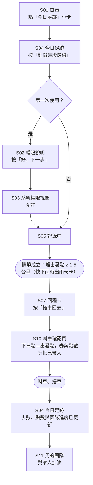
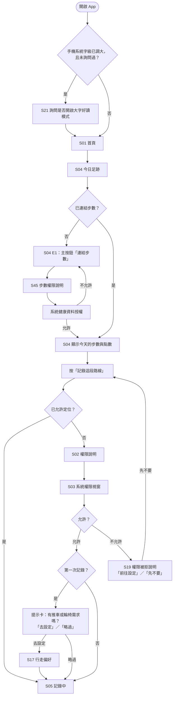
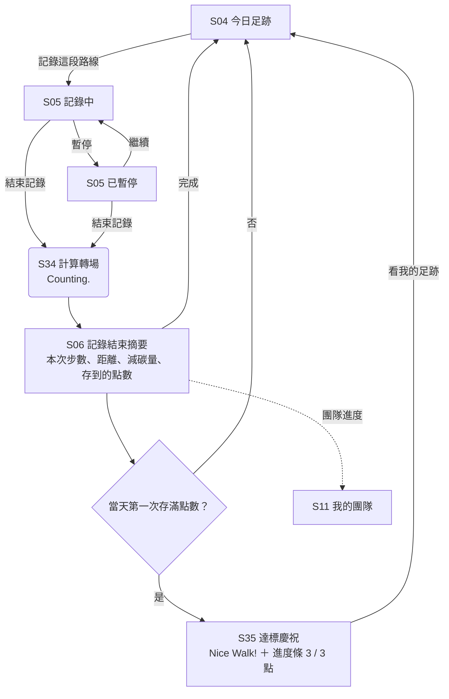
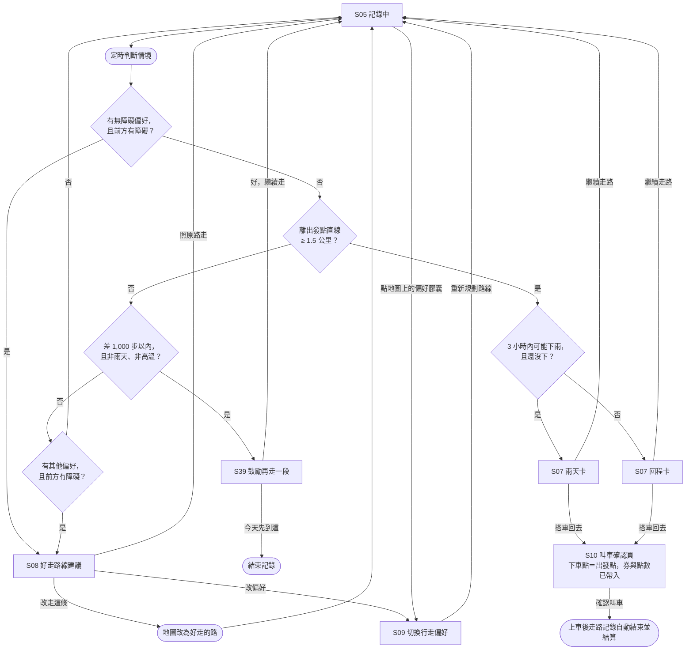
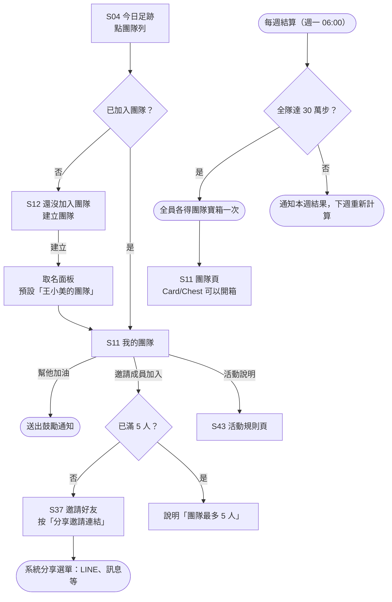
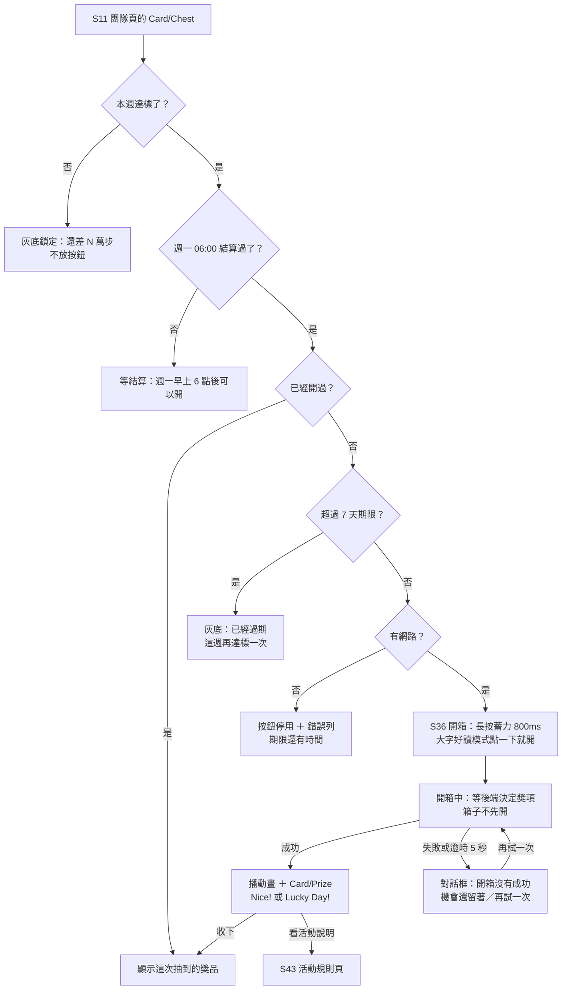
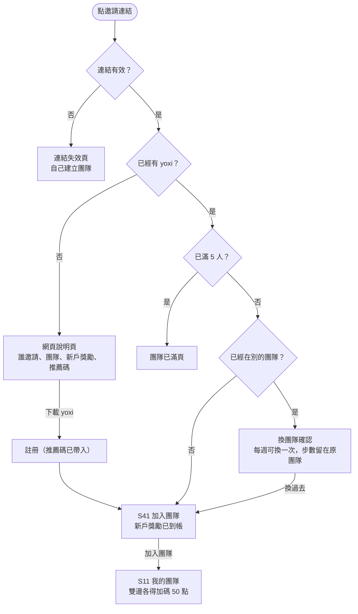
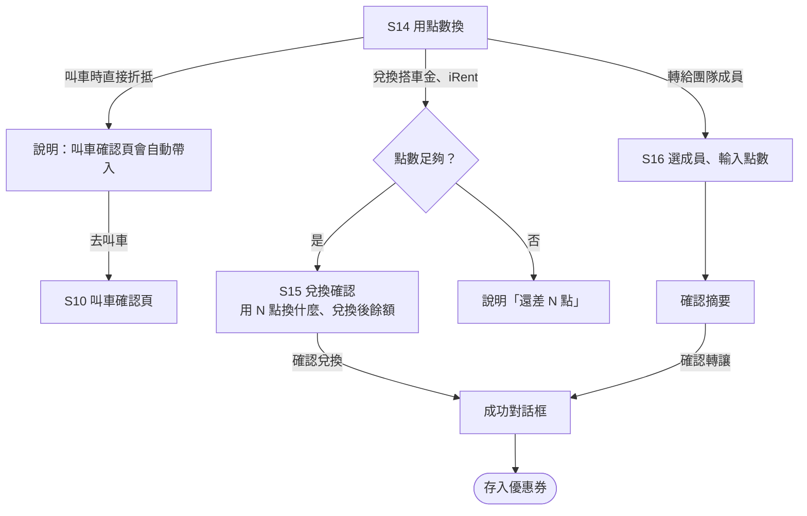
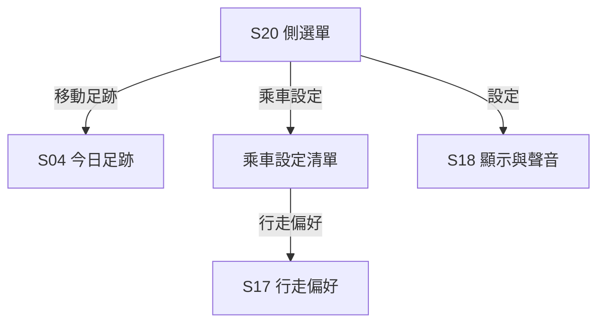
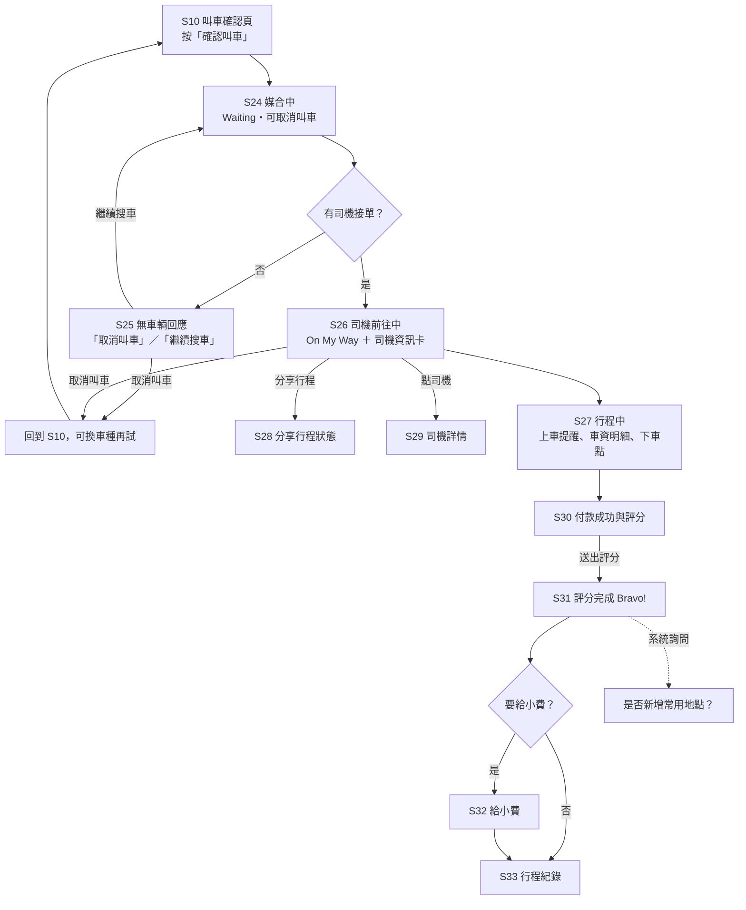

# 1.0 移動足跡 UI Flow

> **狀態：草案**（2026/09/17 建立，2026/09/18 補畫面，2026/09/19 點數機制定案，2026/09/20 補寶箱、邀請與鼓勵卡，2026/09/22 同步決策 #76–#86，2026/09/23 同步 #87–#96、#101–#108）｜依據 `DESIGN.md` 1.24.0｜畫面見 `../03_畫面稿/3-0_主要畫面.html`
>
> 用途：說明 1.0 各畫面之間怎麼跳轉、在哪裡分支、遇到例外時去哪裡，作為 MVP 開發與影片腳本的依據。
> 標示 **〔待確認〕** 的項目需與組員討論後定案，定案後更新本文件。

**閱讀方式**

- 流程圖中的方框是畫面，菱形是判斷，圓角框是系統動作
- 畫面編號對照〈畫面清單〉；`①`–`⑰` 為 mockup 上的編號（9/19 新增 ⑤ 計算轉場、⑦ 達標慶祝，其後編號順延）
- 流程圖在 GitHub 網頁上會直接顯示成圖

---

## 畫面清單

| 編號 | 畫面 | 範圍 | 狀態 | mockup |
|---|---|---|---|---|
| S01 | 首頁（含「今日足跡」小卡） | MVP 必做 | 已畫 | ① |
| S02 | 定位權限說明 | MVP 必做 | 已畫 | ② |
| S03 | 系統權限視窗 | — | 系統畫面 | ②內示意 |
| S45 | 步數權限說明（連結步數） | 設計先行（Prototype 的展示資料預設已連結） | 已畫（9/23，`../03_畫面稿/3-1_今日足跡_四類狀態.html` E1-2，決策 #101） | — |
| S04 | 今日足跡 | MVP 必做 | 已畫（含「記錄這段路線」按鈕；9/23 前叫「開始記錄」） | ③ |
| S05 | 記錄中（含暫停、結束、訊號弱提示） | MVP 必做 | 已畫 | ④ |
| S34 | 結束記錄的計算轉場（`State/Counting`） | MVP 必做 | 已畫（9/19 新增） | ⑤ |
| S06 | 記錄結束摘要（含減碳說明條 `Note/Eco`） | MVP 必做 | 已畫 | ⑥ |
| S35 | 達標慶祝（`Overlay/Celebrate`，當天第一次存滿） | MVP 必做 | 已畫（9/19 新增） | ⑦ |
| S07 | 回程卡／雨天卡（AI 情境卡） | MVP 必做 | 已畫（9/23 改版，狀態見 `../03_畫面稿/3-2_AI情境卡.html`） | ⑨ |
| S08 | 好走路線建議卡 | MVP 必做 | 已畫 | ⑩ |
| S39 | 鼓勵再走一段的建議卡（差一點達標） | MVP 必做 | 已畫（9/20，`Card/Suggest` 鼓勵變體） | ⑳ |
| S09 | 記錄中切換行走偏好 | 設計先行 | 已畫 | ⑪ |
| S10 | 叫車確認頁（點數折抵） | MVP 必做 | 已畫（yoxi 既有畫面的示意） | ⑫ |
| S11 | 我的團隊（含成就區 `Card/Achievement`） | MVP 必做 | 已畫 | ⑧ |
| S12 | 還沒加入團隊（建立團隊） | MVP 必做 | 已畫（9/23，`../03_畫面稿/3-3_團隊頁_叫車確認頁_堅持一週.html`） | — |
| S13 | 邀請成員（系統分享） | — | 系統畫面 | — |
| S14 | 用點數換 | MVP 必做 | 已畫 | ⑭ |
| S15 | 兌換確認 | 設計先行 | **缺** | — |
| S16 | 轉給團隊成員 | 設計先行 | **缺** | — |
| S17 | 行走偏好（設定頁） | 設計先行 | 已畫 | ⑮ |
| S18 | 顯示與聲音 | 設計先行 | 已畫 | ⑯ |
| S19 | 定位權限被拒的說明 | 設計先行 | **缺** | — |
| S20 | 側選單 | MVP 必做 | 已畫（9/23，含 Prototype 的展示資料標示與重設入口） | ㉒ |
| S44 | 重設展示資料的確認 | MVP 必做（**僅 Prototype**） | 已畫（9/23） | ㉓ |
| S21 | 大字好讀模式詢問 | 設計先行 | **缺**（規格已定，見 DESIGN.md 第 11.1 節） | — |
| S22 | 路況回報（回報、拍照、送出、成功） | 設計先行 | **未畫**，功能範圍待組員確認（decision_log #32–#34） | — |
| S23 | 變更支付方式的確認 | MVP 必做 | 已畫 | ⑬ |
| S36 | 團隊寶箱（開箱與結果） | MVP 必做 | 已畫（9/20；9/23 補四類狀態，`../03_畫面稿/3-5_團隊寶箱.html`） | ⑱ |
| S43 | 團隊寶箱活動說明（活動規則頁） | MVP 必做 | 已畫（9/23，`../03_畫面稿/3-5_團隊寶箱.html`） | — |
| ~~S40~~ | ~~今日寶箱~~ **已移除**（決策 #76） | — | mockup ⑰ 已刪 | — |
| S37 | 邀請好友與獎勵說明 | MVP 必做 | 已畫（9/23 改為一列獎勵） | ⑲ |
| S41 | 加入團隊（受邀人） | MVP 必做 | 已畫（9/23，`../03_畫面稿/3-4_邀請與加入團隊.html`） | — |
| S42 | 邀請連結的網頁說明頁（受邀人還沒有 yoxi） | MVP 必做 | 已畫（9/23，`../03_畫面稿/3-4_邀請與加入團隊.html`） | — |
| S38 | 任務視窗（點任務看隊友步數） | MVP 必做 | **缺**（9/19 新增需求，也可能做成 S11 的分頁） | — |
| S24 | 媒合中（Waiting・正在幫您搜尋司機） | 既有流程 | 未畫 | — |
| S25 | 無車輛回應（取消叫車／繼續搜車） | 既有流程 | 未畫 | — |
| S26 | 司機前往中（On My Way ＋ 地圖 ＋ 司機資訊卡） | 既有流程 | 未畫 | — |
| S27 | 行程中（已上車，車資明細與下車點） | 既有流程 | 未畫 | — |
| S28 | 分享行程狀態 | 既有流程 | 未畫 | — |
| S29 | 司機詳情（評分、好評標籤、法規資訊） | 既有流程 | 未畫 | — |
| S30 | 付款成功與評分 | 既有流程 | 未畫 | — |
| S31 | 評分完成（Bravo!） | 既有流程 | 未畫 | — |
| S32 | 給小費與費用明細 | 既有流程 | 未畫 | — |
| S33 | 行程紀錄與行程詳情 | 既有流程 | 未畫 | — |

**範圍欄**：`MVP 必做` 為 Demo 要能操作的畫面；`設計先行` 為畫面與流程先定案、開發視進度（decision_log 決策 #32）；`既有流程` 為 yoxi 現有畫面，我們不重新設計，只確認銜接點，Demo 視需要重現。

**已補畫**（2026/09/18）：S04 的開始記錄按鈕、S05 記錄中、S06 記錄結束摘要、S10 叫車確認頁的點數折抵。

**待補畫面**：S15、S16、S19、S21，以及 S22 路況回報、S38 任務視窗。9/20 已補畫 S36 團隊寶箱、S37 邀請好友、S39 鼓勵卡（mockup ⑱–⑳，DESIGN.md 1.6.0；⑰ 今日寶箱已於 9/22 移除，決策 #76）。

---

## 0. Demo 主流程

影片與 Demo 展示用的一條完整路線，也是 MVP 最先要做通的部分。

**主角〔待確認〕**：9/15 會議建議以上班族為主角、長輩為團隊成員，待組員確認後補上人物設定與情境。

**展示重點**：走路存點數 → AI 在對的時機建議搭車 → 點數直接折抵車資 → 家人團隊一起走、互相加油，對應差異化的三個組合。

---

## 1. 第一次使用

**規則**

- 大字好讀模式只詢問一次，不論答案（DESIGN.md 第 11.1 節）
- 行走偏好**不強制設定**，只在第一次記錄時以提示卡詢問一次，避免增加步驟（建議）
- **步數與定位分開問**（決策 #101）：步數在第一次進今日足跡時問（主按鈕「連結步數」→ S45），定位在第一次按「記錄這段路線」時才問（S02）。一次只問一種權限；拒絕定位仍能存點數（PRD `M5`）
- 使用者之前按過「不允許」，再按「記錄這段路線」時直接顯示 S19，不再跳 S02

---

## 2. 日常記錄

**規則**

- **S34 計算轉場**顯示至少 1.2 秒、最長 3 秒；逾時直接進摘要，不顯示錯誤（DESIGN.md 第 8.12 節 `State/Counting`）
- **S35 達標慶祝**只有當天第一次存滿才跳，一天最多一次；沒存滿的日子不出現，摘要頁照常顯示。慶祝畫面沿用首頁的 `Progress/Trip`，數字與上限照原樣保留
- **慶祝什麼時候跳**（決策 #105）：點數全天自動累積，存滿時多半沒開 App——**存滿後第一次打開今日足跡時跳**；正在記錄時存滿，才照上圖在摘要後跳。不在 yoxi 首頁跳；當天沒打開就不補，只有第 7 天的堅持一週版本保留到下次打開
- 摘要頁的減碳說明條為推估值，文案用比較句「比開車少排約」，係數一手來源待查（DESIGN.md 第 9 章、第 13 章）
- 結束記錄後，摘要頁底部提供「繼續記錄」，按了回到同一段記錄（可反悔，DESIGN.md 第 11.4 節）
- **點數換算（2026/09/19 定案，決策 #42）**：每 2,000 步 1 點，每日目標 6,000 步、封頂 3 點。進度條三格對應 2,000／4,000／6,000 步
- 當天點數達上限後，**繼續記錄步數與距離**，只是不再加點；**超過封頂的步數改計入團隊週目標**（決策 #52），**不設每日計入上限**（決策 #63）
- 封頂後的文字（決策 #52）：有團隊時「今天的點數已存滿，接下來的每一步都會算進團隊」；沒有團隊時「今天的點數已存滿——加入團隊，多走的步數就不會白走」，點擊進 S12
- 記錄中關閉 App 或切到其他 App：背景繼續記錄路線與步數
- **畫面不能讓人以為要按了才存得到點數**（決策 #101）：今日足跡主按鈕寫「記錄這段路線」，點數卡固定一行「手機記下的每一步都自動算點數，不用開著 App」；摘要頁點數列寫「今天的點數 N / 3 點」，不寫「這次存到 N 點」（DESIGN.md 第 8.12 節〈點數是自動累積的〉）
- **雙軌記錄（2026/09/22 定案，決策 #85）**：步數與今日點數由系統計步器（HealthKit／Health Connect）全天自動累積，**不必按記錄**；「記錄這段路線」只記錄一段路線（地圖軌跡、這段的步數與距離），回程卡、雨天卡、好走路線與減碳量都靠這段路線。Demo 以假資料回放步數與示範路線，畫面標示為展示資料

---

## 3. 走路中的建議

**規則**（卡片版面與狀態見 DESIGN.md 第 8.12 節，觸發條件見 PRD 第 4.5 節）

- 一次只顯示一張建議卡。優先序：無障礙路線 ＞ **雨天卡** ＞ **回程卡** ＞ 鼓勵再走一段 ＞ 其他路線（PRD `A3`）
- **回程卡**：離出發點直線 ≥ 1.5 公里（PRD `A6`）。「回去」指出發點，是記錄時自己記下來的，**不需要目的地**
- **雨天卡**：回程卡條件 ＋ 鄉鎮預報未來 3 小時降雨機率 ≥ 70% ＋ 附近測站還沒下雨（PRD `A2`）；文案用小時級，不發券
- 回程卡、雨天卡**每趟各最多 1 次**；鼓勵卡一天最多 1 次
- **拒絕定位或網路斷線時，不出回程卡與雨天卡**；鼓勵卡只需要步數，照常出現
- 卡片在句子、車資、時間都到齊後才出現；Gemini 句子超過 2 秒改用模板句
- 按「搭車回去」進 S10 叫車確認頁：下車點帶入出發點，犒賞券與點數折抵一併帶入
- **只在走路流程裡插入搭車選項，不在搭車流程裡插入走路選項**
- 開啟「走路時語音提醒」時，卡片出現的同時唸出標題並震動（DESIGN.md 第 8.13 節）
- 不倒數、不自動接受

**AI 情境推薦引擎的邊界（決策 #49、#68）**

規則決定「什麼時候說」、Gemini 決定「說什麼」、數字由 Function Calling 取得。AI **只推薦**：不判定步數有效、不發獎勵、不決定券值、不代為叫車。

**Demo 雙情境（決策 #68、#88）**：同一個時刻、同一段路（傍晚、離出發點 1.6 公里），兩個人看到不同的回程卡——A 手上有犒賞券，看到可折抵的金額；B 沒有券但快天黑，看到「再 20 分鐘天黑，走回去約 25 分鐘」。差別來自手上的券與當下的環境，不猜測使用者的身分。

**判斷條件**

| 參數 | 值 | 來源 |
|---|---|---|
| 鼓勵卡的差距門檻 | 差 1,000 步以內，非雨天、非高溫 | PRD `A1` |
| 回程觸發 | 離出發點直線 ≥ 1.5 公里 | PRD `A6`、決策 #66 |
| 降雨判斷 | 鄉鎮預報未來 3 小時 ≥ 70%，且附近測站還沒下雨 | PRD `A2`、決策 #67 |
| 每趟最多提示次數 | 回程卡、雨天卡各 1 次 | PRD `A2`、`A6` |
| 上車後的走路記錄 | 自動結束並結算 | PRD `M1` |
| 判斷頻率 | 〔待確認〕 | — |

---

## 4. 團隊

**開箱**（決策 #92–#94，畫面見 `../03_畫面稿/3-5_團隊寶箱.html`）

- **獎項必須由後端先決定並寫入，再播動畫**；開箱機會的扣除與獎項寫入是同一個動作，失敗就整筆不算
- **機率不對使用者公開**（決策 #92）：S43 只列獎項、不列機率
- 開箱期限為結算後 7 天，到下週一結算前（PRD `R11`）
- **長按要寫出來**（決策 #108）：按鈕寫「長按開箱」並附「按住不放，就會打開」；只點一下時填色退回、箱子輕震、提示字加粗，不跳對話框；大字好讀模式與螢幕閱讀器開啟時改為點一下就開（DESIGN.md 第 11.4 節）
- **建立團隊時取名**（決策 #107）：底部面板預設填好「（使用者名字）的團隊」，上限 12 個字，一鍵就能建立
- **開箱期間的入口提示**（決策 #103）：可以開、還沒開、沒過期時，首頁小卡與今日足跡團隊列的說明行換成「團隊寶箱可以開了・M 月 D 日前」（紅點 ＋ 灰字），順著點就到團隊頁的開箱按鈕；不做開 App 時跳出的面板

**受邀人點開邀請連結**（決策 #90，畫面見 `../03_畫面稿/3-4_邀請與加入團隊.html`）

- Demo 的推薦碼與團隊邀請由展示資料直接帶入，不依賴延遲深層連結
- **邀請獎勵的寫法**（決策 #104）：邀請頁先寫雙邊一定拿得到的「和泰 Points 50 點」，第二行「好友第一次用 yoxi，再各拿 $200 搭車金」；新戶獎勵一律寫 yoxi 對外的「$200 搭車金」
- 邀請連結不設時間限制；團隊滿 5 人、解散或重新產生連結後失效（PRD `T14`）

**規則**（點數與任務規則 2026/09/19 定案，決策 #43–#46）

- **一次只能在一個團隊**，可以換、每週最多換一次；這週已走的步數留在原團隊，寶箱看週一結算當下所在的團隊（PRD `T12`、`T13`）
- **團隊 2–5 人**（決策 #80）；已滿 5 人時「邀請成員加入」仍可按，按下後說明原因（不做停用，DESIGN.md 第 8.1 節）
- **週目標全隊 30 萬步**，採團隊總達成量；**計算週期固定週一～週日**
- **滿 2 人即啟動週挑戰**；只有 1 人時顯示「再邀 1 人就能開始挑戰」，步數照常累計，啟動後保留（決策 #80）
- **目標不隨人數調整**：不論幾人都是 30 萬步。團隊頁顯示「每人每天約需 N 步」與「再邀 N 人，每人每天只要 N 步」，旁邊放邀請入口，文案用邀請語氣、不責備人少（決策 #80）
- **成員週中加入**：目標不打折，其他成員已累計的步數保留，新成員從加入當天起計入；當週未達標，下週重新計算（PRD `T6`）
- **週結算**：計入週一 00:00 至週日 23:59 的步數，週一 06:00 結算，保留時間給離線補傳〔待確認〕（PRD `T4`）
- **成員之間互相看得到步數**，不含軌跡地圖（隱私考量）；`Row/Member` 尾隨統一顯示今日步數
- **達標獎勵為團隊寶箱**，全員各一次、每人每週上限一次；獎項見 PRD `R1`，機率見 PRD `R2`（**不對使用者公開**，決策 #92）
- **開箱期限結算後 7 天**，逾期失效（PRD `R11`，決策 #94）；畫面寫絕對日期
- **開箱標語分兩種**（決策 #93）：基本獎與小獎 `Nice!`，大獎與超級獎 `Lucky Day!`
- 中途加入的隊伍第一週門檻較高，團隊頁顯示「剩 N 天、還差 N 步」，不只給一條進度條
- 同一位成員，「幫他加油」每天最多送一次，入口在點進成員之後（PRD `T10`）

**〔待確認〕**

- ~~團隊寶箱各獎項的機率~~ 已定案（決策 #70，PRD `R2`）；~~機率要不要公開~~ 已定案：不公開（決策 #92）
- ~~開箱期限~~ 已定案：結算後 7 天（決策 #94，PRD `R11`）
- ~~週目標是 30 萬步還是 25 萬步~~ 已定案：30 萬步（決策 #53、#80）
- ~~加入團隊是否需要隊長同意~~ 已定案：不需要，有邀請連結即可加入（PRD `T9`）
- ~~「幫他加油」的位置~~ 已定案：點進成員之後（PRD `T10`）
- 週一 06:00 結算（PRD `T4`）

---

## 5. 使用點數

**規則**

- 兌換與轉讓一律兩步：先顯示摘要，再按動詞按鈕確認（DESIGN.md 第 11.4 節）
- 點數不足時，清單列仍可點，點開後說明還差多少，不做停用
- 入口：S04 的「我的和泰 Points」列、側選單
- **折抵條件**：點數折抵需用信用卡付款（官方）；現金付款不能用優惠券；電子票證可用優惠券、不能用點數；券與點數可同趟併用（PRD `I6`、`R9`）。看得到折抵的地方就要寫出條件，且折抵顯示要跟著支付方式即時連動（DESIGN.md 第 8.12 節）
- **券與點數同時用時的顯示**（決策 #96）：叫車前中間欄寫「**折抵約 $N**」（合計），券與點數只在優惠券清單頁分列（券可改選，點數是不能操作的一行說明，前面用 yoxi 官方的 Ⓟ 符號）；**上車結算後**車資區才分三列寫確定金額，列名沿用 yoxi 的「優惠折抵」。yoxi 現況是叫車前不顯示點數金額，只用 Ⓟ 符號表示自動折抵已開啟
- **「確認叫車」上方說明行**（決策 #102）：這趟會折到點數時寫「含和泰 Points 約 $N・點數折抵需用信用卡付款」，折抵點數為 0 時不顯示；付款方式不能折抵時改寫原因

**〔待確認〕**

- ~~轉讓的上限與對象限制~~ 已定案：限團隊成員、單次上限 50 點（PRD `I4`）
- 兌換項目與點數（目前為示意；yoxi 券要加進清單）
- 抽獎入口是否只留團隊寶箱（建議付點數抽獎移到 2.0）
- 邀請加碼的 50 點為**不可轉讓**（決策 #45），轉讓畫面要能辨識並擋掉這部分點數

---

## 6. 設定

- 在 S09（記錄中）改的偏好，會同步更新 S17（DESIGN.md 第 8.12 節）
- 大字好讀模式切換後立即生效，不需重開 App

---

## 7. 叫車之後（yoxi 既有流程）

依 2026/09/18 實際搭車截圖還原。這段是 yoxi 現有流程，**我們不重新設計**，只需確認 1.0 的銜接點；Demo 要演完整趟時才需要重現這些畫面。

**從截圖確認到的細節**

- 媒合中是滿版墨藍畫面，斜體英文標語（`Waiting`、`On My Way`）＋一行中文說明，和 `State/Empty` 用的是同一套語彙
- 司機資訊卡：車牌、車型、司機姓名、評分、傳訊息、打電話；下方接廣告卡與車資明細
- 行程中可以改下車點、分享行程、取消叫車；**付款方式在行程中乘客端不能自己改，畫面寫「如要變更，請告知司機」**
- 評分頁：先是空心星星（「評分完可給予小費」），送出後出現黃色五星與 `Bravo!`
- 費用明細有減碳量、「有東西忘在車上」、客服入口、刪除此行程紀錄
- 給小費需要先綁定信用卡

**1.0 的銜接點**

| 銜接點 | 做法 |
|---|---|
| 進入 S10 | 由 S07 回程卡／雨天卡「搭車回去」帶入下車點（出發點）、犒賞券與點數折抵 |
| 付款方式變更 | 行程中乘客端不能改，只能告知司機；**我們建議：改動時乘客端要收到通知並確認**（S23，屬司機端需求） |
| 行程結束 | 回到首頁；首頁小卡說明行提示一次「剛剛走的 1.6 公里記下來了」，點下去看那段路的 S06 摘要，按「完成」回 S04（決策 #106） |
| 走路記錄 | **上車後自動結束並結算該段**（PRD `M1`） |

---

## 例外狀態總表

| 情境 | 發生在 | 處理方式 | 畫面 |
|---|---|---|---|
| 定位權限被拒 | 記錄這段路線 | 說明用途，提供「前往設定」 | S19 |
| GPS 訊號弱 | 記錄中 | 地圖上方提示「定位訊號較弱，距離可能不準」，不中斷記錄 | S05 |
| 未授權健康資料 | 今日足跡 | 主按鈕改為「連結步數」，按下進步數權限說明；不顯示 0 步（PRD `M5`、決策 #101） | S04、S45 |
| 健康資料權限被關閉 | 今日足跡 | 「讀不到今天的步數」＋ 前往設定；已入帳點數以灰階保留 | S04 |
| 網路斷線 | 今日足跡 | 步數照常顯示；點數卡提示「連線後點數會自動入帳」 | S04 |
| 點數同步失敗 | 今日足跡 | 自動重試 3 次仍失敗，點數卡顯示「再試一次」，不跳視窗 | S04 |
| 第一次載入 | 今日足跡 | 骨架屏；有上次的資料時先顯示舊數字加「更新中」 | S04 |
| 當天點數已達上限 | 記錄中 | 繼續記錄步數，不再加點 | S04、S05 |
| 沒有替代路線 | 走路中建議 | 不跳路線建議，只標示障礙點 | S05 |
| 開箱送出後沒拿到結果 | 開箱中 | 對話框「開箱沒有成功」，第一句寫**機會還留著**；「再試一次」／「稍後再開」。後端的扣機會與寫獎項是同一個動作 | S36 |
| 開箱逾時 | 開箱中 | 超過 5 秒沒回應直接進上一列的對話框，不做「一直轉」 | S36 |
| 離線時要開箱 | 團隊頁 | 寶箱卡照常顯示，按鈕停用 ＋ 錯誤列「連上網路才能開箱」，補一句期限還有時間 | S11 |
| 開箱逾期沒開 | 團隊頁 | 灰底「上週的團隊寶箱已經過期」＋「這週再達標一次就有新的寶箱」，**不用紅色錯誤樣式** | S11 |
| 這趟用不到犒賞券（車資未滿 $100）| 走路中建議、叫車確認頁 | 券列**整列不顯示**，不寫灰字說明；券仍留在優惠券頁（決策 #95）| S07、S10 |
| 兩種建議同時成立 | 走路中建議 | 依優先序只顯示一張 | S07、S08 |
| 點數不足 | 使用點數 | 說明還差多少點 | S14 |
| 團隊已滿 | 團隊 | 說明最多 5 人 | S11 |
| 叫不到車 | 媒合中 | 顯示「目前並無車輛回應」，提供「取消叫車」與「繼續搜車」；取消後可換車種再叫 | S25 |
| 行程中要改付款方式 | 行程中 | yoxi 現況是乘客端不能改，只能告知司機；我們建議補上乘客端確認 | S27、S23 |
| 支付方式改為現金或電子票證 | 叫車確認頁、行程中 | 先以 `Overlay/Dialog-Confirm` 說明會失去點數折抵與優惠券，確認後折抵列改為「無法折抵」並更新實付 | S10、S23 |
| 網路中斷 | 全部 | 記錄照常；需要連線的動作（叫車、兌換）說明「目前沒有網路，恢復後再試」 | 各頁 |

錯誤訊息的寫法依 DESIGN.md 第 11.5 節：寫「發生什麼事＋現在可以怎麼做」，不出現錯誤代碼。

---

## 待確認事項總表

| # | 項目 | 影響 |
|---|---|---|
| 1 | Demo 主流程的主角與情境 | 影片腳本、Demo 資料 |
| 2 | 叫車建議的判斷條件（距離、降雨、頻率、次數） | 流程 3 的分支、AI 規則 |
| ~~3~~ | ~~上車後走路記錄怎麼處理~~ **已定案：自動結束並結算，回到首頁時提示一次**（PRD `M1`、決策 #106） | 流程 3 的結尾 |
| ~~4~~ | ~~團隊成員之間可見的資料~~ **已定案：只看步數，不含軌跡地圖**（決策 #46） | 流程 4、隱私 |
| 5 | ~~每週結算時間~~（**已定案：週一～週日固定週期**）；加入是否需同意、加油次數仍未定 | 流程 4 |
| 6 | 點數轉讓的上限與對象、兌換項目 | 流程 5 |
| 7 | 司機端變更支付方式時，乘客端要怎麼收到通知與確認（屬司機端，1.0 只在提案建議） | 流程 5、7、提案論述 |
| 8 | Demo 要不要重現叫車後的既有流程（媒合中到評分），還是以截圖示意 | 流程 7、影片腳本 |
| ~~9~~ | ~~團隊成員列的尾隨樣式~~ **已收斂：統一顯示今日步數**（決策 #46 定案隊友步數互相可視後成立） | 流程 4、S11 |
| ~~10~~ | ~~達標慶祝的觸發規則~~ **已定案：存滿後第一次打開今日足跡時跳，一天最多一次**（PRD `M4`、決策 #105） | 流程 2、S35 |
| 11 | 成就的種類與達成條件（連續達標、早起走路、揪團成功、回報路況為示意） | 流程 4、S11 |
| 12 | 減碳係數的一手來源（目前 0.115 kgCO2e／延人公里為二手引用） | S06 文案、簡報論述 |
| ~~13~~ | ~~團隊寶箱各獎項的機率~~ **已定案**（決策 #70，PRD `R2`） | S36、商業模式 |
| ~~14~~ | ~~週目標是 30 萬步還是 25 萬步~~ **已定案：30 萬步**（決策 #53、#80） | 流程 4、S11 |
| ~~15~~ | ~~計步資料來源採方案 A（既有計步器）、B（GPS 軌跡）或雙軌~~ **已定案：雙軌，原生 App，Demo 用假資料**（決策 #85） | 全流程、MVP 技術選型 |
| 16 | 抽獎入口是否只留團隊寶箱（建議付點數抽獎移到 2.0） | 流程 5、S14 |
| 17 | S39 鼓勵卡的觸發門檻與按鈕文案，以及組員版本的討論內容 | 流程 3、S39 |
| ~~18~~ | ~~每日計入團隊的步數上限~~ **已定案：不設上限**（決策 #63） | 流程 2、4 |
| ~~19~~ | ~~個人寶箱是否採用~~ **9/22 已移除今日寶箱**（決策 #76）；犒賞券改由「堅持一週」取得（決策 #71） | 流程 2 |
| ~~20~~ | ~~團隊門檻是否改按人數計算~~ **已定案：固定 30 萬步，團隊 2–5 人、滿 2 人即啟動**（決策 #53、#80） | 流程 4、S11 |

---

## 下一步

1. 組員確認本文件的流程與待確認事項
2. 補畫其餘缺少的畫面（S12、S15、S16、S19、S21、S22、S36、S37、S38），需要新元件時寫回 DESIGN.md
3. 依 9/19 定案改寫 DESIGN.md 與 mockup 的計量單位（每公里 1 點 → 每 2,000 步 1 點；全隊 100 公里 → 30 萬步），並重新輸出圖檔
4. 待確認事項定案後，更新流程圖並把狀態改為穩定
