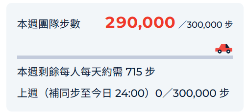

### D1. 01C 每日步數與昨日補同步
1.補同步昨日步數按鈕，點過一次後應該就反灰禁止點選第二次。
2.補同步昨日步數按鈕點選後，本週全勤的"待補"應轉換為"已補"，若步數達標才顯示"達標"。
### D2. 03B-UI 退團與隊長交接
團隊成員目前顯示的名稱是memberId，應該調整為"displayName"。
### D3. 03C-1 團隊週貢獻與進度
1.團隊共享內個人紀錄的文字，原始及有效前面加上"今日"兩字，調整後應為"今日原始"及"今日有效"。本週N步的"本週"兩字應調整成"本週計入"，調整後應為"本週記入"。
2.團隊共享內，本週團隊步數計算有問題。我日期設定為10/5 09:00，10/5步數模擬為290000、補同步昨日步數模擬為111111。
本週團隊步數應該為401111，但下圖仍顯示為290000。
上週（補同步至今日 24:00）應顯示為111111／300,000 步，但下圖顯示為0／300,000 步。

### D5. 04A 七日全勤與乘車券
1.輸入模擬車資試算下方的墨藍色方框應為常駐顯示，目前是要點選後顯示方框。

